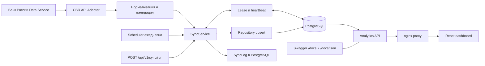
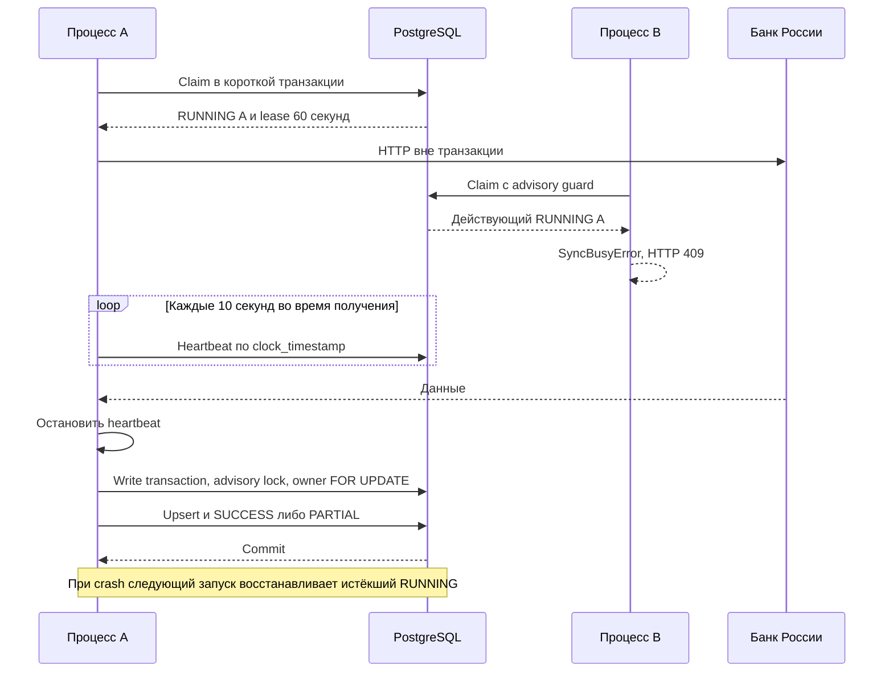

# Архитектура MVP

## Компоненты и границы

Backend — модульный монолит на Fastify. Модули CBR, sync, mortgage и analytics работают
в одном Node.js-процессе. Prisma обращается к PostgreSQL. React собирается Vite
и раздаётся отдельным nginx, который проксирует `/api`, `/health`, `/docs` к backend.
Compose поднимает backend, frontend и PostgreSQL 17. Kafka, Redis и отдельного worker
в текущем MVP нет.

| Компонент                       | Ответственность                                                      |
| ------------------------------- | -------------------------------------------------------------------- |
| CbrApiClient / CbrApiDataSource | HTTP, каталоги, доступные годы, raw archive и сбор замечаний         |
| cbr.mapper                      | RUB, перевод единиц, период, валидация и source metadata             |
| SyncService                     | Владение запуском, heartbeat, запись наблюдений и завершение SyncLog |
| MortgageRepository              | Сравнение текущей записи и upsert по уникальному ключу               |
| MortgageService / analytics     | Ряды, карточки, средний кредит, MoM и YoY                            |
| React                           | Отображение полученных через внутренний API данных                   |
| Swagger/OpenAPI                 | Машиночитаемый контракт шести endpoints и интерактивная документация |

## Общая архитектура

Вызов источника происходит внутри жизненного цикла SyncService **после claim**, но
до транзакции записи. Стрелки от адаптера показывают передачу данных, а не порядок
получения блокировки. [Диаграмма синхронизации](../../assets/competition/diagrams/synchronization.mmd)
показывает порядок управления.

## Надёжность

Локальный флаг `active` предотвращает повторный запуск в одном экземпляре сервиса.
Между процессами короткая claim-транзакция берёт `pg_try_advisory_xact_lock` в
пространстве схемы и блокирует строку RUNNING. Действующий lease означает отказ
конкуренту. Частичный уникальный индекс разрешает только одну RUNNING-запись.
HTTP-запросы и нормализация выполняются без открытой транзакции и без закреплённого
соединения. Heartbeat продлевает lease каждые 10 секунд на следующие 60 секунд
по часам PostgreSQL.

Перед записью heartbeat останавливается с ожиданием текущего продления. Write-транзакция
получает общий advisory lock и проверяет владельца через `SELECT ... FOR UPDATE`.
Row lock сохраняется до commit/rollback. Изменение наблюдений и финальный SyncLog
атомарны. Таймаут записи по умолчанию 30 секунд. При ошибке SQL данные откатываются,
а FAILED фиксируется отдельно, если БД доступна.

Истёкший RUNNING следующий запуск переводит в FAILED и создаёт собственный log.
Старый процесс после перехвата не пройдёт проверку владельца. Восстановление не
автономное и не мгновенное: необходим следующий запуск после окончания lease.

## Конкурентный запуск

## Диаграммы и исходники

Четыре редактируемых Mermaid-файла:
[архитектура](../../assets/competition/diagrams/architecture.mmd),
[поток данных](../../assets/competition/diagrams/data-flow.mmd),
[синхронизация](../../assets/competition/diagrams/synchronization.mmd),
[конкурентный запуск](../../assets/competition/diagrams/concurrent-sync.mmd).
Mermaid можно просматривать средствами поддерживающего его Markdown-редактора.
Диаграммы хранятся в редактируемом формате Mermaid.

Основания: [SyncService](../../src/modules/sync/sync.service.ts),
[миграция](../../prisma/migrations/202610210001_sync_lease/migration.sql),
[Compose](../../compose.yaml), [тесты конкуренции](../../tests/integration/sync.test.ts).
