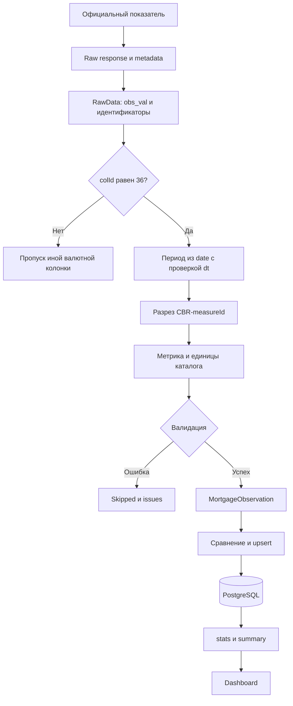

# Жизненный цикл наблюдения

## Пример одного значения

Реальный snapshot [количества ИЖК](../../data/samples/mortgage-count.json) содержит
рублёвые строки dataset 44, publication 21, measure 22. У строки за январь 2026
`dt="Январь 2026"`, а `date="2026-02-01T00:00:00"`. Число кредитов извлекается из
`obs_val`, а не из заголовков или строки отображения. Происхождение snapshot и
его контрольная сумма находятся в [provenance](../../data/samples/provenance.json).

| Шаг                              | Действие в реальном коде                                                                                  |
| -------------------------------- | --------------------------------------------------------------------------------------------------------- |
| 1. Выбор официального показателя | Каталог задаёт metric, publicationId, datasetId, reporting, unit и multiplier                             |
| 2. Получение                     | Адаптер проверяет активную публикацию, dataset, measures и years, затем вызывает data                     |
| 3. Raw response                  | CbrApiClient сохраняет тело и метаданные попытки в `data/sync-raw/<uuid>/`                                |
| 4. Извлечение                    | parseData проверяет внешний объект, mapper обрабатывает RawData построчно                                 |
| 5. Валюта и разрез               | Сохраняется только colId 36, проверяются element_id 36 и measure_id 22                                    |
| 6. Период                        | Для месячной выдачи date первого числа следующего месяца согласуется с dt. Результат: 2026-01-01          |
| 7. Регион                        | measure 22 преобразуется во внутренний код CBR-22, имя берётся из measures                                |
| 8. Метрика и единицы             | MORTGAGE_COUNT, credits, множитель 1. Для сумм unit_id 6 переводится из млн RUB в RUB                     |
| 9. Валидация                     | Проверяются month, единица, дата, конечность/неотрицательность, целочисленность количества и переполнение |
| 10. Нормализованное наблюдение   | MortgageObservation включает value, metric, period, regionCode и source metadata                          |
| 11. Сохранение                   | Repository сравнивает запись и выполняет upsert только при вставке/изменении                              |
| 12. Аналитика                    | stats возвращает ряд, summary вычисляет сравнения и средний кредит                                        |
| 13. Dashboard                    | React отображает данные внутреннего API, фильтры, графики и таблицу                                       |

## Смысл нормализации

Frontend работает с одним контрактом `period=YYYY-MM`, именованными metric и RUB.
Он не зависит от номера валютной колонки, формата `dt` и того, в какой публикации
находится ставка. Mapper делает правила преобразования явными и проверяемыми.
Внешний формат остаётся внутри адаптера, а ошибки не превращаются в нулевые значения.

Для задолженности и просрочки исходная дата означает состояние на первое число
месяца. В общей таблице оно относится к предыдущему отчётному месяцу как остаток
на его конец. `sourcePeriodDate` сохраняет исходное первое число, чтобы смысл
не потерялся. Методология summary описывает это правило.

## Метаданные и идемпотентность

В БД хранятся `source`, `sourcePublicationId`, `sourceDatasetId`, `sourceMeasureId`,
`sourceUpdatedAt` и `sourcePeriodDate`. `importedAt` относится к загрузке приложением,
а `sourceUpdatedAt` — к dataset ЦБ. Это разные события. Время dataset не доказывает
момент изменения каждой строки. Raw хранится отдельно от БД, UUID архива отдельно
не записывается в модель SyncLog, поэтому прямую FK-связь log→raw не заявляем.

Уникальный ключ `(regionId, period, metric)` закреплён схемой БД. Repository
сравнивает Decimal value, unit, source и все перечисленные source metadata.
При совпадении счётчик skipped растёт без upsert. При отличии выполняется update,
при отсутствии — insert. Даже изменение времени dataset может привести к update
без изменения самого числового значения. Это не проверка только `updated_time`
и не механизм инкрементальной загрузки: источник повторно запрашивает настроенный
период. Lease и блокировки сериализуют конкурирующие импорты.

Основания: [mapper](../../src/modules/cbr/cbr.mapper.ts),
[repository](../../src/modules/mortgage/mortgage.repository.ts),
[схема](../../prisma/schema.prisma), [summary](../../src/modules/mortgage/mortgage.service.ts).
