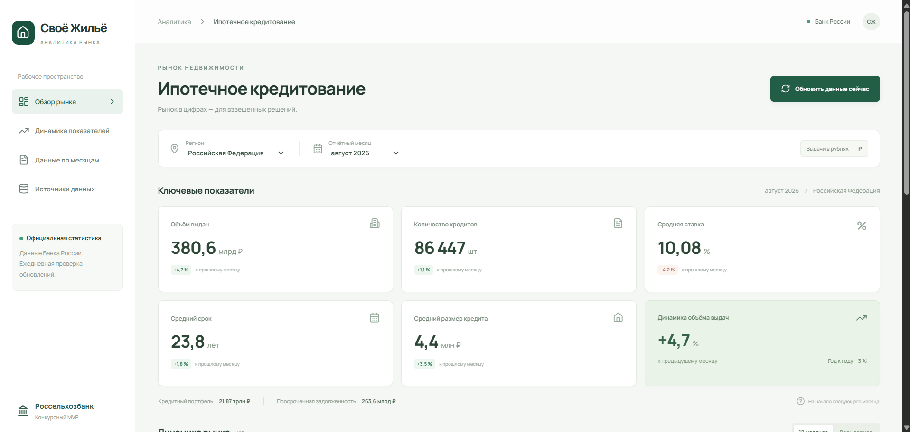
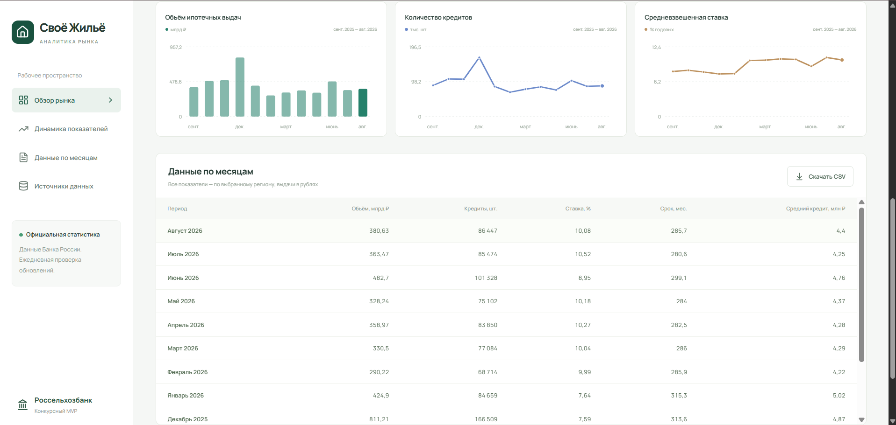

# Конкурсная презентация

Одиннадцать слайдов: задача, архитектура, интеграция, интерфейс, аналитика и результаты.

## Слайд 1. Ипотечная аналитика для «Своего Жилья»

### Основные тезисы

- Стипендиальная программа АО «Россельхозбанк» 2026–2027
- Автоматический сбор и подготовка данных Банка России
- Копытина Римма Дмитриевна НИУ МИЭТ, магистратура 09.04.03 группа П-11М

### Заметки докладчика

Система автоматического сбора аналитических данных предназначена для будущего раздела аналитики портала «Своё Жильё». Ипотечный MVP охватывает шесть исходных метрик Банка России и четыре территориальных разреза. Полный цикл включает получение официальной статистики, нормализацию, хранение, расчёты и отображение.

Источники: docs/competition/project-summary.md; src/modules/cbr/cbr.catalog.ts.

## Слайд 2. Данные ЦБ и задачи портала

### Основные тезисы

- Порталу нужны сопоставимые показатели и регулярное обновление с контролем результата.

| Внешний формат               | Контракт для портала           |
| ---------------------------- | ------------------------------ |
| Разные публикации            | Единый набор метрик            |
| Месяц и техническая дата     | Общий отчётный месяц           |
| Валютные колонки и млн ₽     | RUB и согласованные единицы    |
| Новые значения и исправления | Загрузка с журналом результата |

### Заметки докладчика

Официальный API предоставляет статистику в нескольких публикациях. В ответах различаются обозначения периода, валютные колонки и единицы измерения. Сервис объединяет правила преобразования, хранит историю загрузок и предоставляет порталу единый аналитический контракт.

Источники: docs/cbr-api-research.md; src/modules/cbr/cbr.mapper.ts.

## Слайд 3. Автоматизированный цикл обновления

### Основные тезисы

- Ежедневная проверка источника, месячная статистика
- Банк России
- Нормализация и валидация
- PostgreSQL
- Наш API
- Dashboard
- Запуск по расписанию, при старте или вручную
- Сохраняются исходные ответы и метаданные

### Заметки докладчика

Scheduler проверяет источник ежедневно. Возможны также стартовая загрузка и ручной запуск. Адаптер проверяет каталоги, mapper выбирает RUB, согласует период и переводит суммы в рубли. PostgreSQL хранит наблюдения с метаданными источника. Внутренний API отдаёт ряды и сводку dashboard.

Источники: src/modules/cbr/cbr.service.ts; src/modules/cbr/cbr.mapper.ts; src/modules/mortgage/mortgage.service.ts; src/modules/sync/sync.scheduler.ts.

## Слайд 4. Архитектура MVP

### Основные тезисы

- Банк России Data Service
- Fastify + TypeScript
- CBR · Sync · Mortgage · Analytics
- Scheduler и ручной запуск
- PostgreSQL Prisma · SyncLog
- nginx proxy
- React dashboard
- Swagger описывает API. Docker Compose запускает три сервиса.

### Заметки докладчика

Backend работает как модульный монолит на Fastify и TypeScript. Модули интеграции, импорта и аналитики разделены по ответственности. Prisma обращается к PostgreSQL, nginx раздаёт React и проксирует API. Compose запускает три сервиса, Swagger описывает контракт.

Источники: src/app.ts; compose.yaml; deploy/nginx.conf; prisma/schema.prisma.

## Слайд 5. Правила интеграции с Банком России

### Основные тезисы

- Шесть метрик и четыре территориальных разреза
- Выдачи за январь
- Техническая дата: 01.02.2026
- Отчётный месяц: 2026-01
- Остаток на 1 февраля
- Состояние на конец января
- Исходная дата сохранена
- Используется только рублёвый разрез
- Суммы: млн ₽ × 1 000 000 = ₽

### Заметки докладчика

Рабочий импорт получает количество, объём, срок, задолженность и просрочку из публикации 21, ставку — из 15/34. Выдачи за январь имеют техническую дату первого февраля. Остаток на первое февраля относится к концу января. Mapper проверяет подпись и дату, сохраняет исходную дату, выбирает рублёвую колонку 36 и переводит суммы из миллионов рублей в рубли.

Источники: docs/competition/api-integration.md; data/samples/mortgage-count.json; data/samples/mortgage-debt.json; src/modules/cbr/cbr.mapper.ts.

## Слайд 6. Dashboard и аналитика

### Заметки докладчика

На экране выбран рублёвый ипотечный сегмент РФ за август 2026. Видны фильтры региона и месяца, карточки объёма, количества, ставки, срока и среднего кредита. Карточки показывают месячные изменения, а блок динамики объёма также содержит сравнение год к году. Под карточками отражены кредитный портфель и просроченная задолженность.

Источники: assets/competition/screenshots/02-dashboard-overview.png; frontend/src/App.tsx.

## Слайд 7. Dashboard и аналитика

### Заметки докладчика

Графики показывают динамику объёма, количества и средневзвешенной ставки. Ниже находится месячная таблица с выгрузкой CSV. Фильтры региона и периода определяют показанный ряд.

Источники: assets/competition/screenshots/03-dashboard-table.png; frontend/src/App.tsx.

## Слайд 8. Dashboard и аналитика

### Основные тезисы

- Пример данных: РФ, август 2026 · рублёвые выдачи
- Выбор региона и отчётного месяца
- Карточки, графики, таблица и CSV
- MoM и YoY в интерфейсе
- Источник: снимки ответов ЦБ от 20.10.2026. Средний кредит = объём / количество.

| Показатель     | Значение       |
| -------------- | -------------- |
| Объём          | 380,633 млрд ₽ |
| Количество     | 86 447 шт.     |
| Средний срок   | 285,7 мес.     |
| Средний кредит | 4,40 млн ₽     |

### Заметки докладчика

Пример нормализованных данных РФ за август 2026: объём 380,633 млрд рублей, количество 86 447 кредитов, средний срок 285,7 месяца. Средний кредит 4,40 млн рублей рассчитан делением объёма в рублях на количество. Исходные значения сохранены в ответах ЦБ от 20.10.2026. MoM и YoY объёма представлены в интерфейсе; API предоставляет сравнения и для других метрик.

Источники: data/samples/mortgage-count.json; data/samples/mortgage-volume.json; data/samples/mortgage-term.json; src/modules/mortgage/mortgage.service.ts.

## Слайд 9. Надёжность синхронизации

### Основные тезисы

- Процесс A получает lease
- PostgreSQL один RUNNING
- Процесс B HTTP 409
- Повторная загрузка
- Upsert по региону, месяцу и метрике
- SyncLog хранит статус и счётчики
- После аварии
- Heartbeat прекращается, lease истекает
- Следующий запуск восстанавливает импорт

### Заметки докладчика

Repository сравнивает значения и метаданные по региону, месяцу и метрике. Неизменившаяся запись увеличивает skipped, новая вставляется, исправленная обновляется. PostgreSQL разрешает только один RUNNING. Heartbeat продлевает lease, перед атомарной записью повторно проверяется владелец. После аварии восстановление происходит при следующем запуске после истечения lease.

Источники: src/modules/sync/sync.service.ts; src/modules/mortgage/mortgage.repository.ts; tests/integration/sync.test.ts.

## Слайд 10. Проверки и реальные результаты

### Основные тезисы

- 14 unit-тестов
- 9 integration-тестов
- PostgreSQL, два процесса и аварийное завершение
- 480 наблюдений после обоих импортов
- Дубли по (region, period, metric) отсутствуют

| Импорт    | Получено | Вставлено | Обновлено | Пропущено | Записей в БД |
| --------- | -------- | --------- | --------- | --------- | ------------ |
| Первый    | 1280     | 480       | 0         | 800       | 480          |
| Повторный | 1280     | 0         | 0         | 1280      | 480          |

### Заметки докладчика

В ревью от 21.10.2026 прошли 14 unit-тестов и 9 интеграционных тестов на PostgreSQL, включая два OS-процесса, аварийное завершение и восстановление. Первый импорт в отдельном чистом Compose-стенде: received 1280, inserted 480, updated 0, skipped 800. Повторный: received 1280, inserted 0, updated 0, skipped 1280. После каждого импорта в БД 480 наблюдений. Проверка ключей не обнаружила дублей. Raw содержит валютные колонки, поэтому received отличается от количества сохранённых наблюдений.

Источники: docs/final-review.md; docs/competition/testing.md.

## Слайд 11. Результат MVP и следующий этап

### Основные тезисы

- Готово
- Сквозной цикл получения и подготовки ипотечных данных
- Единый API для портала
- Шесть метрик, четыре разреза, RUB
- Повторный импорт без дублей
- Перед production
- Авторизация ручного sync
- Мониторинг и browser E2E
- Расширение регионов и истории
- Результат: готовый интеграционный слой для автоматического наполнения раздела «Аналитика» актуальными данными Банка России.
- Архитектура допускает подключение дополнительных регионов, метрик и источников.

### Заметки докладчика

Ипотечный MVP предоставляет воспроизводимый цикл обработки официальной статистики и единый API для будущего раздела портала. Перед публичной эксплуатацией необходимы авторизация ручного sync, мониторинг и браузерные проверки. Расширение регионов, истории и остальных банковских показателей требует проверки источников и методологии.

Источники: docs/competition/project-summary.md; docs/competition/limitations.md.

Результат: интеграционный слой для автоматического наполнения раздела «Аналитика» официальными данными Банка России. Расширение регионов, метрик и источников — направление развития архитектуры.
